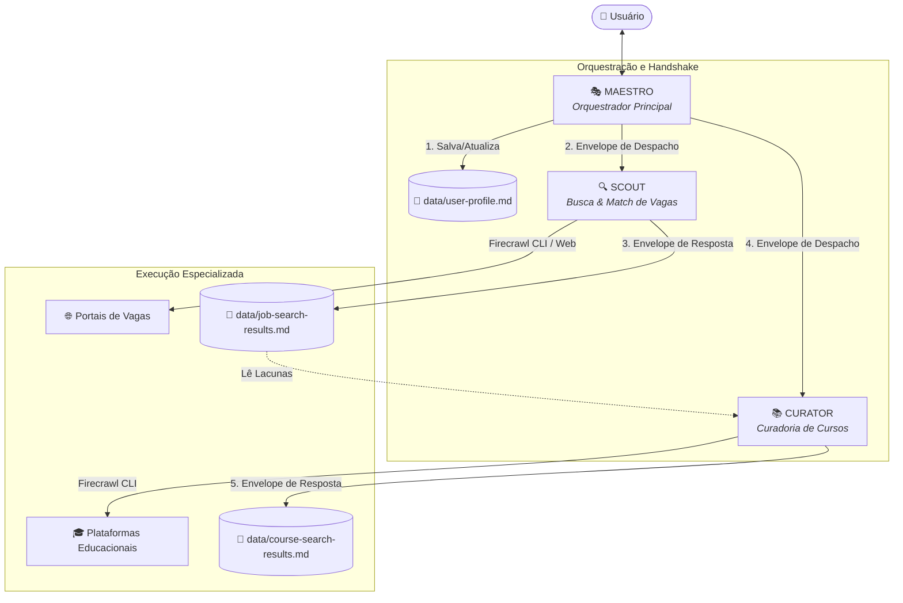

# 🚀 Agent Recruiter — Orquestrador de Vagas Tech

> **Sistema Multi-Agente Inteligente** para recrutamento, mapeamento de lacunas de habilidades e qualificação profissional personalizada.


---

## 📌 Visão Geral do Projeto

O **Agent Recruiter** é uma arquitetura de múltiplos agentes autônomos baseada em **Mixture of Experts (MoE)** e **Prompt Engineering Declarativo**. Ele atua como um assistente de carreira inteligente para a área tech, realizando:

1. **Diagnóstico do Perfil**: Questionário estruturado de interesses, senioridade e stack tecnológica.
2. **Mineração e Matching de Vagas (Scout)**: Busca ativa em portais (LinkedIn, Glassdoor, Indeed, InfoJobs, ProgramaThor) via **Firecrawl CLI**, comparando requisitos das vagas com as competências do candidato.
3. **Curadoria de Capacitação (Curator)**: Identificação precisa de lacunas técnicas (*skill gaps*) e recomendação direcionada de cursos (ex.: Alura) para aumentar a empregabilidade.
4. **Simulação de Entrevistas (Coach - Roadmap)**: Treinamento comportamental e técnico adaptativo.

---

## 🏗️ Arquitetura do Sistema



---

## 🤖 Agentes Especializados

| Agente | Responsabilidade | Ferramentas / Skills | Saída Principal |
| :--- | :--- | :--- | :--- |
| **Maestro** | Interface principal, condução do quiz, coordenação e controle de fluxo | `personas/maestro.md`, `skills/dispatch.md` | `data/user-profile.md` |
| **Scout** | Mineração de oportunidades, matching bidirecional de habilidades | `personas/scout.md`, `skills/job-search.md`, Firecrawl CLI | `data/job-search-results.md` |
| **Curator** | Diagnóstico de lacunas e recomendação de cursos preparatórios | `personas/curator.md`, `skills/course-search.md`, Firecrawl CLI | `data/course-search-results.md` |
| **Coach** | Simulação de entrevistas técnicas e comportamentais *(Roadmap)* | `personas/coach.md` *(em desenvolvimento)* | Feedback de performance |

---

## 📑 Protocolo de Handoff (Envelopes)

A comunicação entre o **Maestro** e os agentes especialistas é padronizada através de **Envelopes Estruturados**:

### Exemplo de Despacho (Maestro ➔ Scout)
```markdown
## DESPACHO: SCOUT
### referencia_persona: personas/scout.md
### tarefa: Buscar vagas para backend em Remoto
### perfil_usuario: [conteúdo de data/user-profile.md]
### contexto: Nível: junior | Habilidades: java, springboot, react, node, sql, git
### saida_esperada: Envelope de resposta com até 5 vagas analisadas
```

### Exemplo de Resposta (Scout ➔ Maestro)
```markdown
## RESPOSTA: SCOUT
### estado: sucesso
### resumo: Encontradas 5 vagas com correspondência de requisitos
### dados:
1. titulo: Desenvolvedor Back end [Júnior / Pleno]
   empresa: Devellop Labs
   localizacao: Remoto
   link: https://jobs.recrutei.com.br/...
   habilidades_correspondentes: [node, typescript, sql]
   habilidades_faltantes: [docker, testes unitários]
   contagem_correspondencia: 3 de 5 habilidades correspondem
```

---

## 📂 Estrutura de Arquivos

```text
agent-recruiter/
├── personas/                   # Definições comportamentais dos agentes
│   ├── maestro.md             # Orquestrador
│   ├── scout.md               # Especialista em busca de vagas
│   └── curator.md             # Especialista em cursos
├── skills/                     # Instruções operacionais e comandos CLI
│   ├── dispatch.md            # Protocolo de despacho de agentes
│   ├── job-search.md          # Lógica de scraping e matching de vagas
│   └── course-search.md       # Lógica de curadoria de cursos
├── data/                       # Repositório de dados e estado do usuário
│   ├── personality-quiz.md    # Respostas brutas do questionário
│   ├── user-profile.md        # Perfil consolidado do candidato
│   ├── job-search-results.md  # Vagas mineradas e análise de requisitos
│   └── course-search-results.md # Cursos mapeados para cobrir lacunas
├── run.py                      # Executável CLI interativo (Terminal)
├── maestro_flow.md             # Algoritmo de inicialização e menu
├── plano.md                    # Plano de arquitetura MoE
├── plano-aula-2.md             # Plano de implementação do Scout
├── plano-aula-3.md             # Plano de implementação do Curator
└── Agent Recruiter Presentation.pdf # Slides completos da arquitetura
```

---

## ⚡ Como Executar o Projeto

Você pode rodar este projeto de **duas formas**:

### Opção 1: Via Terminal (CLI Interativo)

Para testar a orquestração diretamente pelo console:

1. Clone o repositório e acesse a pasta:
   ```bash
   git clone https://github.com/SEU_USUARIO/agent-recruiter.git
   cd agent-recruiter
   ```
2. Execute o script principal:
   ```bash
   python run.py
   ```
3. Navegue pelo menu:
   - `[A]` Despachar **Scout** para busca de vagas com análise de compatibilidade.
   - `[B]` Despachar **Curator** para busca de cursos da Alura que preencham suas lacunas.
   - `[D]` Visualizar perfil atual.

### Opção 2: Via Agente de IA (Zed / Claude / Antigravity)

1. Abra a pasta do projeto no editor/ambiente com suporte a agentes de IA.
2. Inicie a conversa solicitando ao modelo para carregar `personas/maestro.md` e iniciar o fluxo descrito em `maestro_flow.md`.
3. O modelo personificará o **Maestro**, conduzirá o questionário e orquestrará as ferramentas via linha de comando (`firecrawl search` e `firecrawl scrape`).

---

## 🛠️ Tecnologias e Conceitos Utilizados

- **Multi-Agent Systems (MAS)**: Separação estrita de responsabilidades entre agentes autônomos.
- **MoE (Mixture of Experts) Guidelines**: Prompts determinísticos, saída estruturada chave-valor e integridade de dados sem alucinação.
- **Web Mining**: Integração com **Firecrawl CLI** para busca e scraping em tempo real com fallback para HTTP/cURL.
- **Desenvolvimento de Carreira Baseado em Dados**: Matching booleano e ponderado de competências técnicas.

---

## 👨‍💻 Autor

Desenvolvido por **[MuriloDev1](https://github.com/MuriloDev1)**  
Projeto focado em estudos avançados de **Inteligência Artificial Agêntica** e **Engenharia de Prompts**.
